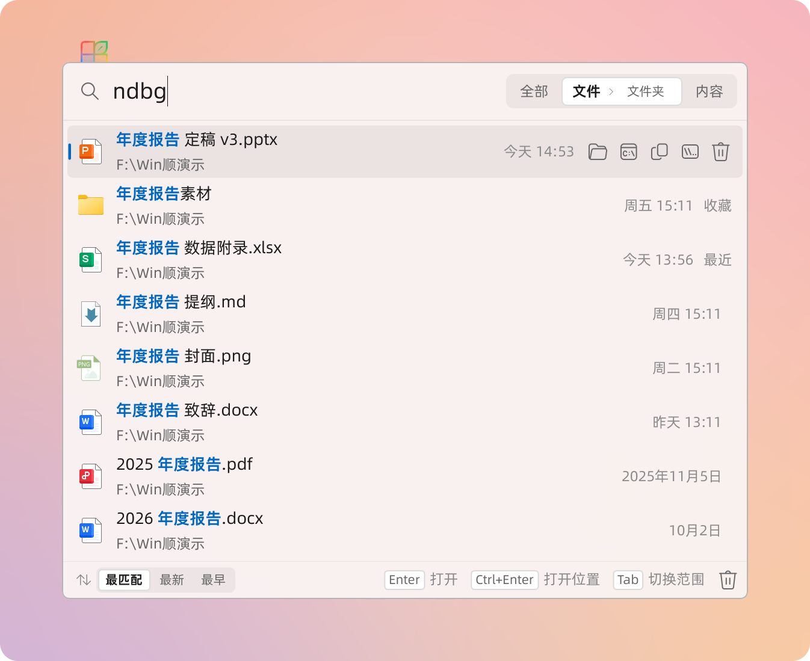
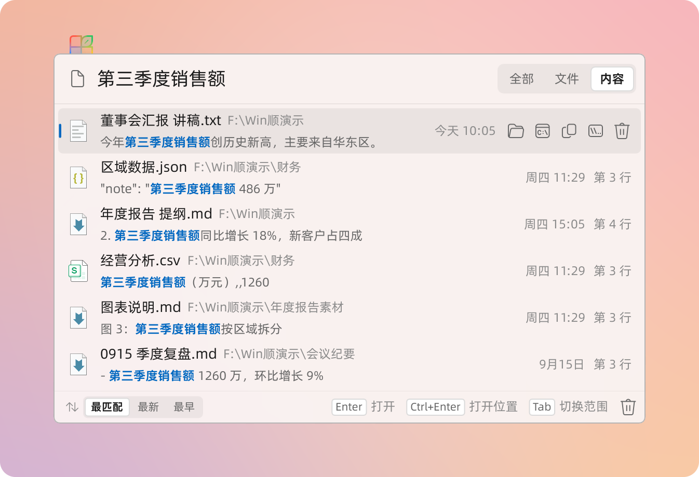
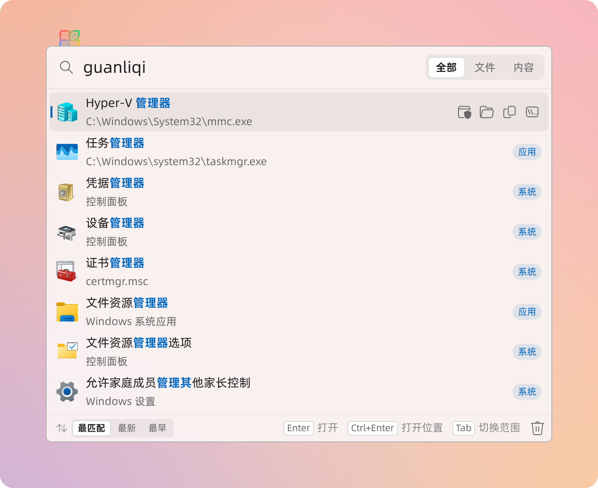
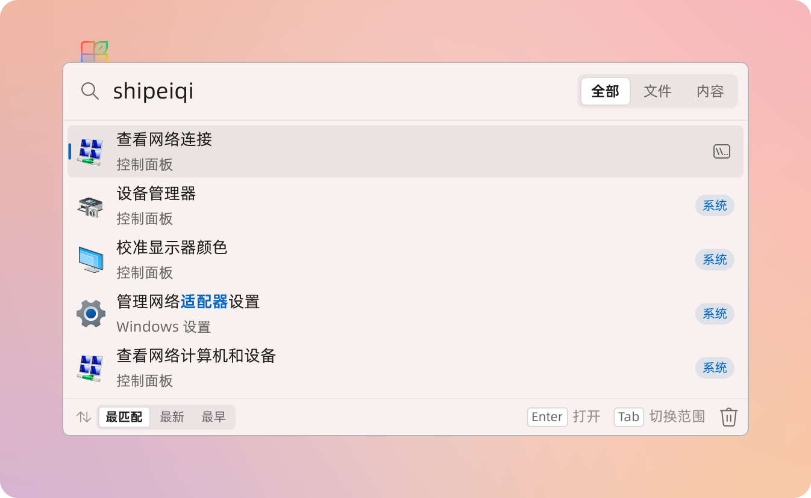
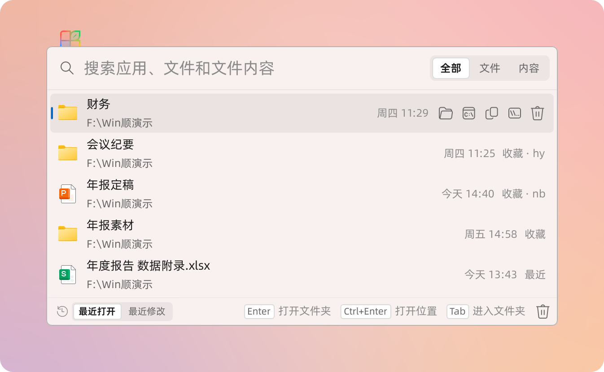
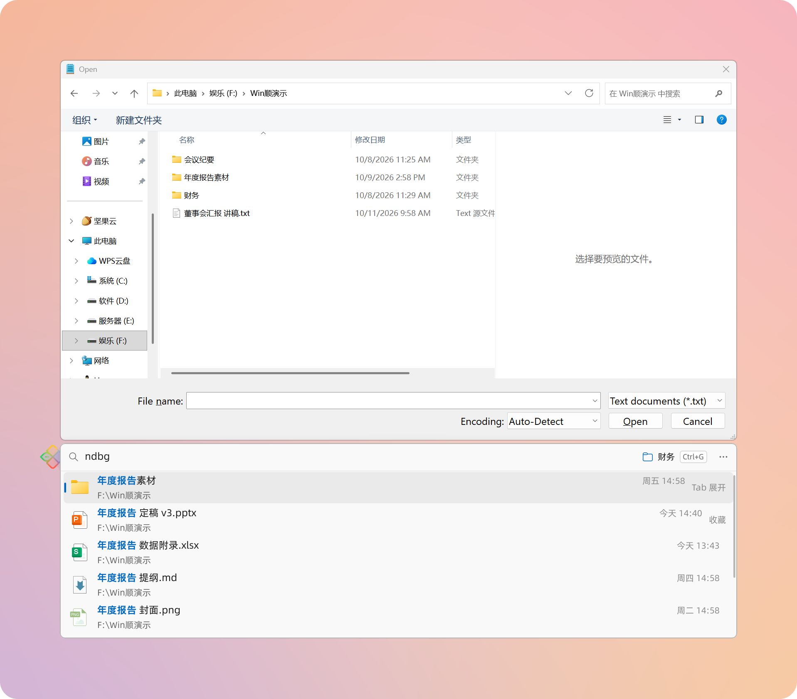
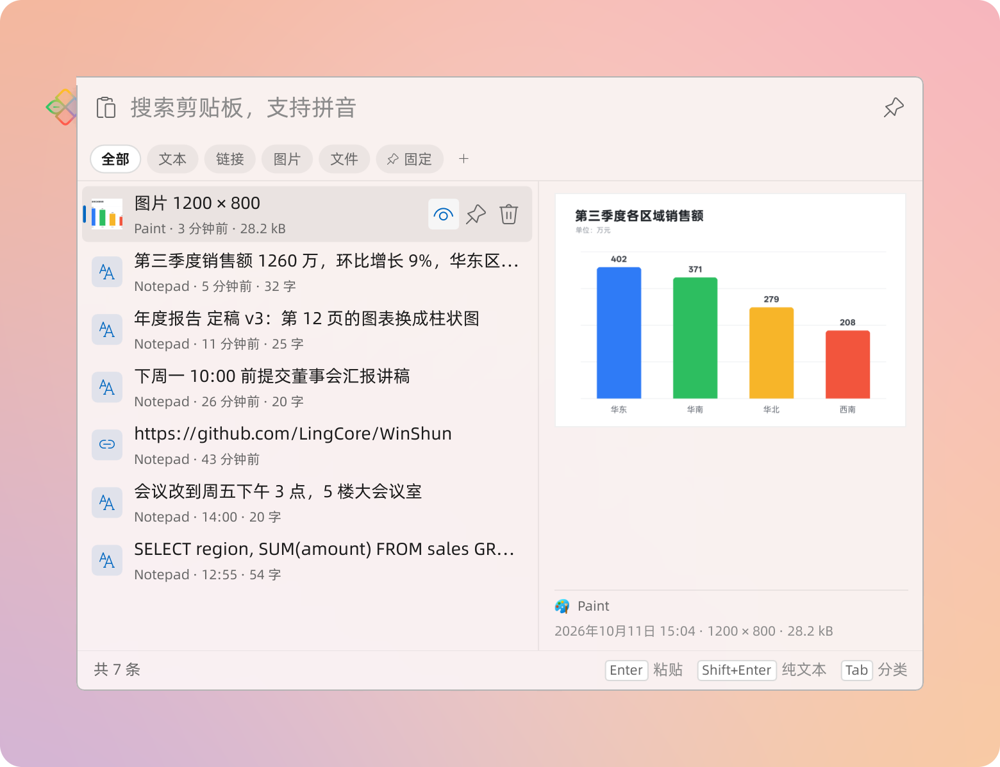
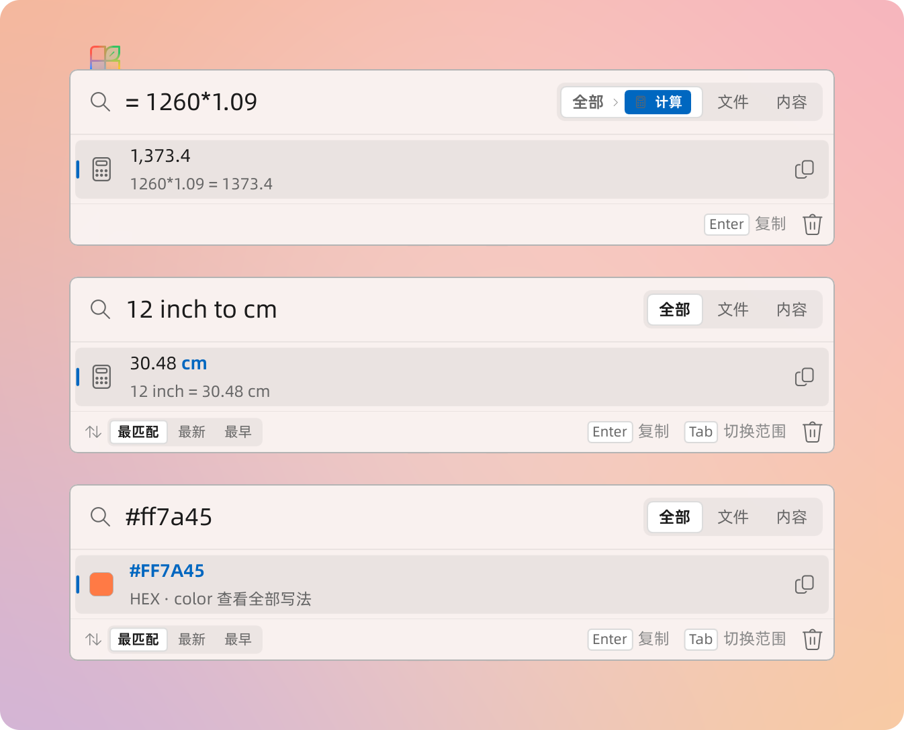
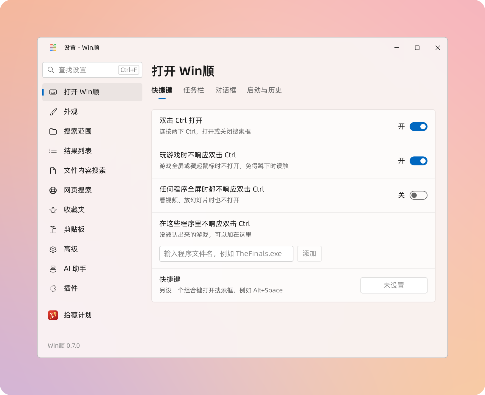

<p align="center">
  
</p>

<h1 align="center">Win顺 · WinShun</h1>

<p align="center">
  <b>双击 Ctrl，搜遍整台电脑</b> —— 免费开源的 Windows 快速搜索启动器<br>
  <b>Press Ctrl twice, search your whole PC</b> — a free, open-source search launcher for Windows
</p>

<p align="center">
  <a href="https://github.com/LingCore/WinShun/releases/latest"></a>
  
  
  <a href="LICENSE"></a>
  <a href="https://linux.do"></a>
</p>

<p align="center">
  <a href="#中文">中文</a> · <a href="#english">English</a>
</p>

<p align="center">
  <picture>
    <source media="(prefers-color-scheme: dark)" srcset="docs/images/search-dark.png">
    
  </picture>
</p>

---

<a id="中文"></a>

## 中文

**Win顺 是什么？** 一个 Windows 上的快速搜索启动器。连按两下 Ctrl，屏幕上弹出搜索框，边打字边出结果：按文件名或拼音找文件和文件夹，打开已安装的应用和 Windows 设置，也能找文本文件里的文字。不用装 Everything，也不用写任何配置。

它直接读 NTFS 的主文件表建索引，三百多万个文件几秒就能建好，之后文件的增删改名都实时跟上。它常驻在任务栏右下角的托盘里，除了到 GitHub 检查新版本、第一次显示某个网页搜索时取一次那个网站的图标以外不联网，不需要账号，完全免费。界面有简体中文和英文两种，默认跟随 Windows 的显示语言，也可以在设置里随时切换。

### 功能

#### 🔍 文件搜索

- **连按两下 Ctrl** 打开搜索框，再按一次或按 Esc 关闭。三百多万个文件里搜一次，一般只要几毫秒。
- **支持拼音和首字母**：`bg`、`baogao`、`baog` 都能找到“报告”，`ndbg` 找到“年度报告”；多音字按常用读音（“银行”用 `yh` 或 `yinhang`）。
- **搜整台电脑**：所有本地磁盘；U 盘和移动硬盘可以在设置里打开。
- **也搜内网的共享文件夹**：公司或家里 NAS、别的电脑共享出来的文件夹，在设置里加上就和本机文件一起搜，一样快；服务器关机时收录过的照样能搜到，标着“离线”。需要密码的点“登录”，用的是 Windows 自己的凭据管理器。
- **排序懂你**：自己的文件排在前面，系统目录、程序目录、`node_modules`、`.git` 排在后面；最近打开过的排得更前。不输入时列出最近打开的 5 项，底栏一点（或 `Ctrl+S`）换成最近修改的文件（往下滚动接着列出）：编译输出、缓存、日志、下载到一半的这些程序自己写的文件不算，只列你在做的。名字和输入的完全一样的（输入 `readme` 时的 `README.md` 和 readme 文件夹）排在最前；文件和文件夹分开排，默认文件在前，设置里可以改成文件夹在前；匹配得一样好的，最近修改的在前。
- **只找文件夹**：选中 **文件** 范围时旁边出现 **文件夹**，点它（或接着按 `Tab`）就只列文件夹。
- **修改日期**：每个文件和文件夹的名字右边写着上次修改的时间（今天 14:32、昨天、周三、10月3日……），鼠标停在上面看完整日期。默认最匹配的在前；底栏左边可以改成按修改时间排，最新的在前或最早的在前（`Ctrl+S` 轮换），文件内容匹配也一起排（**全部** 里应用、设置和网址仍在最前），找最新的那一版、或者最早的原稿都方便。选过的会记住。
- **数字键直接打开**：按住 `Ctrl` 片刻，每行右边标出序号，按 `Ctrl+1`～`Ctrl+9` 打开看得见的第几行，不用先选。设置里可以改成 `Alt+1`～`Alt+9` 或关掉。别的程序把这些键设成了全局快捷键（截图工具常用 `Ctrl+1`）也没关系：搜索框在前面时归 Win顺，其他时候照旧归那个程序，设置里会写出被占用的是哪几个。
- **拖出去就能用**：按住搜到的文件或文件夹拖出去，放进微信、QQ 的聊天框、邮件、资源管理器的文件夹或任何能收文件的程序，和从资源管理器里拖一样；`Ctrl` 点选几项一起拖。拖进文件夹是复制，不会把原文件移走。
- **索引实时更新**：文件改名、新建、删除马上就能搜到。插上新磁盘自动收录，拔掉的自动移除；“安全删除硬件”时 Win顺 会先放开这块磁盘，不会提示“设备正在使用”。
- **搜索语法**：

| 写法 | 含义 |
|---|---|
| `报告 2024` | 每个词都要找到（空格分隔，顺序不限，不区分大小写）：最好都在文件名里；也可以有的在它所在的文件夹名里，只要至少一个在文件名里（`src app` 找到 `src\app`，`合同 ext:pdf` 找到“合同”文件夹里的 PDF），这样的排在后面；在文件夹名里找到的词，在下面那行路径里标出来 |
| `ndbg`、`niandubaogao` | 拼音：每个汉字用读音或读音开头的几个字母，可以混用（如 `ndbaog`）；字母和数字照常匹配（`v2bg` 找“v2报告”） |
| `"年度 报告"` | 引号内作为一个整体，包括空格 |
| `!草稿` | 排除文件名含“草稿”的 |
| `!node_modules\` | 排除名字含 `node_modules` 的文件夹里的所有内容；`!临时\*.log` 只排除这种文件夹里的 `.log` |
| `*.pdf`、`报告?.docx` | 通配符：`*` 任意多个字符，`?` 一个字符 |
| `ext:pdf,docx` | 只要这些扩展名的文件 |
| `项目\readme` | 文件名含 `readme`，并且在某个名字含“项目”的文件夹下（文件夹名也可以用拼音：`xm\readme`） |
| `tools/out/covers/` | 从中间某一级写起的路径（`/` `\` 都行）：真有这个位置时它排第一行，按回车就进去，下面照常列匹配的；以 `/` 结尾时只认文件夹 |
| `D:\My Files\报告` | 完整路径（可以直接粘贴，空格算路径的一部分）：先列这个文件夹里名字含“报告”的，再列更深处的；以 `\` 结尾时列出文件夹里的全部内容 |

#### 📄 文字内容搜索

- 切到 **内容** 范围，找文件里的文字，结果里直接显示命中的那一行和行号；文档显示在第几页、第几张幻灯片，或哪个表的第几行。
- **多个词**：`报告 2025` 找同时含有这两个词的文件，词不必挨着、也不必在同一行；显示含词最多的那一行，没在这一行的词从它出现的地方摘几个字接在后面（中间用 … 隔开），每个词都标出来。`"年度 报告"` 用引号括起来就照原样找整个短语。像代码的一行（含 `=` `;` `(` `)` 之类）照原样整行找。
- **按相关度排**：几个词在同一行、是完整的词（`fix` 不算 `prefix` 里的）、文件名里也有、在你自己的文件夹、最近改过的排在前面；压缩成一行的代码和数据文件排在后面。结果边读边出，你正在看、正要选的那一行不会被后来的挤走。
- **也搜文档**：Word、Excel、PowerPoint（新旧格式都行：docx/doc、xlsx/xls、pptx/ppt）、PDF 和 WPS 文件。文档由一个单独的、权限受限的进程读取（没有管理员权限、低完整性级别），坏文件最多让它自己退出；读出的文字存进内容索引，搜索时不用再读一遍。扫描件和图片里的文字读不到。
- 纯文本默认搜 txt、md、log、csv、ini、json、xml、html 和常见源代码，可以在设置里增删扩展名。
- 大小上限按种类分：文本和日志 64 MB、源代码 8 MB、数据和网页 16 MB（更大的多是打包压缩的脚本和导出的数据）、文档 512 MB（大多是图片，每个最多读出 16 MB 文字），设置里可改。
- **自动识别编码**：UTF-8（含 BOM）、UTF-16、GBK 等本地编码都能正确读出。
- **有内容索引**：搜中文，或三个以上连着的英文、数字、空格和标点（比如一整行代码）时，先用索引筛掉不可能含有它的文件，只打开剩下的，几十万个文件也很快。搜索时读过的文件也会记进索引，再搜就不用重读。
- 在 **全部** 范围里，停止输入后也会搜文件内容，排在文件名结果后面，一行代码照原样找（引号、`*`、`!` 都算）。默认跳过系统、程序目录和 `node_modules` 等。

<p align="center">
  <picture>
    <source media="(prefers-color-scheme: dark)" srcset="docs/images/content-dark.png">
    
  </picture>
</p>

#### 🚀 打开应用

- 已安装的应用和开始菜单的“所有应用”一致：桌面程序和 Microsoft Store 应用都有。
- 按名称、拼音、英文首字母（`vsc` 找 Visual Studio Code）或程序文件名（`winword` 找 Word）搜索；不输入时先列最近打开的。
- 在 **全部** 范围里依次是：应用和系统设置、文件、文件夹、文件内容。**文件** 范围只有文件和文件夹（默认文件在前），**文件夹** 范围只有文件夹，**内容** 范围只搜文件里的文字。
- 应用像在开始菜单里一样以普通权限打开；需要时按 `Ctrl+Shift+Enter` 以管理员身份运行。

<p align="center">
  <picture>
    <source media="(prefers-color-scheme: dark)" srcset="docs/images/apps-dark.png">
    
  </picture>
</p>

#### 🧭 直达系统设置

- 输入“适配器”“网卡”或 `ncpa.cpl` 都能打开“网络连接”：Windows 设置里的页面、控制面板里的项目和任务（约 1200 个）按名称和关键词都能搜到，拼音也行，名称和关键词随 Windows 的显示语言。
- 关键词来自 Windows 自带的设置检索清单（开始菜单搜设置用的就是它）；Win顺 又补了一批平时的叫法（网卡、梯子、开机启动、显示隐藏文件……），以及开始菜单里没有的工具和文件夹（磁盘管理、组策略、本地用户和组、启动文件夹、hosts 所在文件夹、AppData……）。
- 在 **全部** 范围里和应用排在一起，标着“系统”，最多列 5 个；同样以普通权限打开，需要管理员权限的由 Windows 自己弹出确认。

<p align="center">
  <picture>
    <source media="(prefers-color-scheme: dark)" srcset="docs/images/places-dark.png">
    
  </picture>
</p>

#### 🌐 网页搜索

- 给常去的网页起个关键词，输入它按 Enter 就打开，后面跟上文字就直接在那个网站上搜：`baidu 天气`、`zhihu 显卡`、`jingdong 键盘`。自带 10 个常用的：`baidu` 百度、`biying` 必应、`bilibili` 哔哩哔哩、`zhihu` 知乎、`weibo` 微博、`douyin` 抖音、`xhs` 小红书、`taobao` 淘宝、`jingdong` 京东、`fanyi` 百度翻译。其余的在 设置 → 网页搜索 里自己加、改、删；每个网站可以换成自己选的 PNG 图标，整张列表能导出成一个文件、在另一台电脑上导入（图标一起带走）。
- 自己加时，网址里用 `%s` 代表要搜的文字：关键词 `gh`、网址 `https://github.com/search?q=%s`，输入 `gh WinShun` 按 Enter 就在 GitHub 上搜索 WinShun。搜索网址最简单的拿法：在那个网站上搜一下 `%s`，把浏览器地址栏里的网址整个粘贴进来。
- 每个网站显示它自己的图标（浏览器地址栏左边那个），第一次显示时取一次，存在本机；深色主题下看不清的垫一块浅色底。
- 不输关键词，输入名称也能找到（中文名称可以打拼音，`jd` 就是京东），标着“网页”，和应用排在一起。用默认浏览器打开；搜过什么不会记进最近使用。

#### ⭐ 收藏夹

- 常去的文件夹、常用的文件、应用和系统设置，在搜索结果上右键“加入收藏夹”；什么都不输入时它们排在最前，输入时匹配的收藏也排在前面，标着“收藏”。
- 给收藏起一个关键词（比如 `gz`），只输入 `gz` 按 Enter 就打开；收藏的文件夹按 `Tab` 进去，接着搜里面的东西。
- 在 设置 → 收藏夹 里拖动排序、改名、设关键词，把文件或文件夹拖进来就能添加，还可以导出、导入到另一台电脑。删掉或挪走了的收藏标着“已不存在”，可以重新选择或移除。
- “打开”“另存为”对话框旁的搜索框用的是同一份收藏。

<p align="center">
  <picture>
    <source media="(prefers-color-scheme: dark)" srcset="docs/images/favorites-dark.png">
    
  </picture>
</p>

#### 📂 “打开”“另存为”对话框：搜一下就到

- 别的程序弹出“打开”“另存为”对话框时（网页上传文件、另存为、选择文件夹都算），旁边会贴着一个 Win顺 搜索框：输入文件夹或文件的名字（拼音也行），回车，对话框直接转过去。选的是文件，就转到它所在的文件夹并填好文件名，再按一次回车就能打开或上传；“打开”对话框里按 `Ctrl+Enter` 一步打开。对话框选了文件类型（比如只收图片的上传框）时，这类文件排在前面。WPS Office 自己的“打开”“另存为”对话框也认。
- 搜索框右边是文件管理器正在显示的文件夹，点一下或按 `Ctrl+G` 就转过去，和 Listary 的同名快捷键一样：先在文件管理器里找到要存的地方，再回到程序里“另存为”，按一下就到。资源管理器、Total Commander 和 Directory Opus 都认，取最近用过的那个窗口。Windows 11 开着几个标签页时取正在显示的那个，Total Commander 取有焦点的那一栏；显示的不是磁盘上的文件夹（“主页”“此电脑”、搜索结果、压缩包里）时，取再往前的一个窗口。
- 点进搜索框，或在对话框里双击 Ctrl，就能开始输入；什么都不输入时依次列出：文件管理器里开着的文件夹（右边标着是哪个文件管理器的）、刚复制的路径（在资源管理器里复制的文件或文件夹、“复制文件地址”、聊天里发来的路径都行）、收藏的文件夹、最近用过的文件夹（包括在别的程序里打开、保存过文件的地方）；对话框已经在的那个文件夹标着“当前位置”。右键一个文件夹选“加入收藏夹”，常去的地方就一直排在前面（和启动器里的收藏是同一份）。“另存为”里文件夹排在前面，“选择文件夹”里只列文件夹。`Ctrl+Shift+C` 复制选中那一行的路径，`Esc` 回到对话框。
- 也可以直接输入路径（`D:\`、`D:\项目\`，带引号的、`%USERPROFILE%` 这样的也行）：列出那个文件夹里有什么，再输入名字的一部分（拼音也行）筛选；`Tab` 进入选中的文件夹，`Shift+Tab` 回到上一级，回车转过去。
- 想让对话框自己转过去，就在设置里打开“对话框自动转到文件管理器的文件夹”（默认关）：对话框一出现就转到文件管理器正在显示的文件夹；对话框开着时去文件管理器换了文件夹，切回来也跟着转，只是过去看一眼就不动。转过去以后，搜索框右边会出现“回到…”，点一下回到程序原来记着的位置。
- 搜索框最右边的“更多”按钮可以收藏对话框当前的文件夹、这次不显示搜索框，或者在某个程序里不再显示（在设置里可以恢复）。
- 搜索框放在对话框下面；下面放不下搜索框和列表，就放到右边或左边；哪边都放不下，对话框一出现就调矮一点（矮到一定程度还放不下就往上挪），列表不会盖住对话框。设置里也可以固定放在下面、左边或右边，那边放不下时对话框调小一点或挪开。Windows 按程序记住对话框的大小，下次弹出来就是合适的大小。对话框开着时自己拖动、拖大，不会被改回去。
- 已经输入的文件名保留，键盘焦点也回到原处。搜索框不抢对话框的焦点，跟着对话框移动，切到别的窗口就隐藏；只有这类对话框在最前面时才占用 `Ctrl+G`。两样都能在设置里分别关掉；同时开着 Listary 的话两边都会响应，关掉其中一个就好。
- 平时用 Total Commander 或 Directory Opus 的话，在设置 → 打开 Win顺 → 对话框 →“用哪个文件管理器打开文件夹”里选它：从 Win顺 打开文件夹、打开文件所在的位置，就在它里面开（Total Commander 开新标签、光标停在那个文件上；Directory Opus 已经有标签显示那个文件夹就用那个，并选中文件）。没装的不列出来。

<p align="center">
  <picture>
    <source media="(prefers-color-scheme: dark)" srcset="docs/images/dialog-dark.png">
    
  </picture>
</p>

#### 📋 剪贴板历史（可以代替 Win+V）

- 复制过的文字、图片和文件都记下来，随时找回。在设置 → **剪贴板** → 快捷键 里打开“用 Win+V 打开”，`Win+V` 出来的就是 Win顺的剪贴板，代替 Windows 自带的；也可以另设一个组合键，或者从托盘菜单打开。
- 点一条在右边预览它；点这一行的粘贴按钮、双击它，或选中后按 `Enter`，直接粘贴到打开之前所在的窗口；`Shift+Enter` 粘贴为纯文本。从 Word、网页复制的内容带着原来的格式；复制的文件粘贴到资源管理器里还是文件。
- 剪贴板开在正在打字的地方：输入光标那一行的正下方，左边和光标对齐，不挡住这一行；下面放不下就开在这一行上面。找不到输入光标时（比如焦点不在输入框里），开在鼠标指针处。拖到别处只管这一次，下次照旧开在光标旁边。
- 剪贴板不抢焦点，和 Windows 自带的一样：原来的程序留在前台，VS Code 的命令面板（`Ctrl+P`）、浏览器地址栏的下拉建议这类一失去焦点就关掉的东西都还开着，粘贴就落在里面。键盘照样操作剪贴板（打字搜索、方向键、`Enter`、`Esc`），点别处或换到别的窗口它就收起。搜索时直接打拼音，不经过输入法；给分组起名字时剪贴板才拿到焦点，可以用输入法打中文。
- 在 Win顺 自己的输入框里（搜索框、对话框旁的搜索框、设置里的输入框）按 `Win+V`，选中的文字就填回这个框里光标的位置，多行的变成一行，文件填它的路径；`Esc` 不粘贴，回到这个框，原来打的字和选中的部分都还在。剪贴板就在这个框的正下方打开（下面放不下就开在上面），框留在原处、选中的字一直看得见；启动器下面的列表先收起来，点一下搜索框就回去接着搜。
- **能搜**：边打字边筛选，支持拼音（`hy` 找到“会议”）；`@程序名` 只看从某个程序复制的（`@wx` 只看微信里复制的）。点一条（或按 `Alt+P`；光标在搜索框文字末尾时也可以按 `→`）在旁边打开预览：这一条的全文、大图或文件清单，还有它从哪个程序复制、什么时候复制的；再点这一条、再按一次或按 `Esc` 收起。预览开着时关掉剪贴板，下次打开还开着。
- **图片里的字也能搜**：复制的图片由 Windows 自带的文字识别读出里面的字（在本机，不联网），搜索时一起找，这一行显示命中的那一段，预览里列在图下面。需要 Windows 装有这种语言的文字识别（设置 → 时间和语言 → 语言，一般随语言一起装好）。
- **分类**：按 `Tab` 在 全部 / 文本 / 链接 / 图片 / 文件 之间切换。颜色值（`#3B82F6`、`rgba(…)`、`hsl(…)`，带透明度的也认）显示成色块，半透明的一半不透明、一半垫着棋盘格，一眼看出有多透；预览里列出它的 HEX / RGB / HSL 写法（半透明的再加一行 Qt、Android、XAML 用的 `#AARRGGBB`，透明度在前），点一下就复制；复制的图片、视频、PDF 等文件，预览里显示缩略图。
- **分组**：`Ctrl+P` 固定一条；右键 → 移到新分组，可以建“常用回复”“代码片段”这样的分组。放进分组的内容一直保留，其余的默认保留最近 200 条（内存 16 GB 及以下 100 条）、30 天，可以在设置里改（50 到 300 条）。
- **多选粘贴**：按住 `Ctrl` 点击，或者 `Shift+↑` `Shift+↓`，选中的每一条都标着序号；按 `Enter` 按这个顺序合在一起，一次粘贴出来。选了一条还能接着搜下一条再选（搜“地址”选一条，再搜“电话”选一条）。中间用什么隔开（换行、空格、逗号、Tab、不分隔），在底栏点一下就能换。选的全是文件时，合成一份文件列表粘贴。
- **钉住**：点剪贴板窗口右上角的图钉，它就一直浮在最上面，粘贴后、点别处、切换程序都不收起，也不抢焦点：在哪个程序里打字，双击一条（或点它的粘贴按钮）就粘贴到哪个程序，可以一条接一条地往表格、表单里填。要用键盘挑，再按一次快捷键或点搜索框；`Esc` 把键盘还给原来的程序。再点一下图钉取消钉住，窗口就和平时一样，点别处收起。
- 按住 `Alt`，前 9 条标出数字，`Alt+1`～`Alt+9` 直接粘贴；`Delete` 删除一条，删错了（删掉整个分组也一样）按 `Ctrl+Z` 撤销。
- **隐私**：密码管理器复制的密码不会被记录（它们会声明“不要记录”，和 Windows 自带的剪贴板历史遵守的是同一套规则），也可以在设置里列出不记录的程序，或者在托盘菜单里暂停记录。历史只保存在本机（`%LOCALAPPDATA%\WinShun\clipboard`），不上传。
- Windows 自带的剪贴板历史是开着的，Win顺的剪贴板历史也默认打开；否则在设置 → 剪贴板里打开。接管 `Win+V` 要重启一次资源管理器（设置里有按钮，也可以等下次登录 Windows 时自动生效）；关掉这项或卸载 Win顺 后，`Win+V` 回到 Windows 自带的剪贴板。Windows 剪贴板面板里的表情符号可以改用 `Win+.` 打开。

<p align="center">
  <picture>
    <source media="(prefers-color-scheme: dark)" srcset="docs/images/clipboard-dark.png">
    
  </picture>
</p>

#### 🔎 代替任务栏上的 Windows 搜索

- 设置 → 打开 Win顺 → 任务栏 里是一张四步的卡片，照着点完就行，做好的一步自动打勾。第一步打开“在任务栏上放 Win顺 的搜索框”（Windows 11），任务栏的图标旁边就多了一个 Win顺 的搜索框：点它直接打字，结果从任务栏后面滑出来、列在它上方，中文输入法的候选条也在框上；搜的是 Win顺 的索引、拼音和设置页。按住框左边的图标可以把它拖到任务栏别的空地上（图标左边、右边或屏幕最左边都行），开关程序时它跟着图标一起挪。地方窄时它和 Windows 自带的搜索一样缩成“搜索”两个字或只剩一个图标，点它打开 Win顺，再点一下收起。
- Windows 10 上没有搜索框，第一步改为固定一个按钮：点“固定”，Windows 会问是否把 **Win顺 搜索** 固定到任务栏，选“是”。之后点这个按钮，Win顺 就在它上方打开，再点一下收起。
- 推荐在任务栏设置里把 Windows 自带的搜索隐藏，两个都留着也可以。Windows 不允许别的程序替你隐藏，设置里有按钮直接打开那一页。
- 从任务栏打开、还没打字时，上面一排是你最常用的 6 个应用（按 `↑` 进去，`←` `→` 选，`Enter` 打开），下面是最近打开的。
- 在设置里打开“在开始菜单里打字，也用 Win顺 搜索”：按 `Win` 后直接打字，Win顺 在任务栏上方打开，打的字接着进去；想用 Windows 自带的搜索时，先按一下左 `Alt` 再打字。
- 在设置里打开“用 Win+S 打开”，`Win+S` 也在任务栏上方打开 Win顺。`Win+Shift+S` 截图照常可用（由 Win顺 替你打开截图工具）。接管 `Win+S` 和 `Win+V` 一样要重启一次资源管理器；关掉这项或卸载 Win顺，它就回到 Windows 搜索。

#### 🤖 让 AI 助手用 Win顺 搜索（MCP）

- Win顺 是一个 MCP（Model Context Protocol）服务器：Claude Desktop、Claude Code、Cursor、VS Code 等 AI 助手连上以后，就能用 Win顺 搜文件名（拼音也行）、搜文件里的文字、列最近改过的文件、看文件夹里有什么——和你在搜索框里一样快。问它“上周改过的那份合同在哪”“哪个文件里写了第三季度销售额”，它直接去找。
- 在 设置 → **AI 助手** 里打开“允许 AI 连接”，再到 **连接客户端** 标签里点一下“连接”，就写进那个客户端的配置（原文件先备份一份；装了的客户端才列出来），重启客户端就能用；其他支持 MCP 的客户端把 `WinShunMcp.exe` 加为 stdio 类型的服务器即可，页面上有“复制路径”和“复制 JSON”。
- 默认只读：AI 看到的是索引里的文件名、修改时间和命中的那一行，不会改动任何文件；而且只看得到你平时不提权时看得到的文件——Win顺 虽然以管理员身份运行，每个结果都按 AI 客户端自己的权限检查过。要让它能打开文件、或者读剪贴板历史，在 **权限** 标签里分别打开；**隐私与记录** 标签里可以加“不让 AI 看到的文件夹”，里面的东西不会出现在它的结果里；每次调用都记在 `mcp.log` 里，“调用记录”旁一点就打开。
- Win顺 没运行时 AI 会得到一条说明，启动 Win顺 就接着能用，不用重启客户端。

#### 🧩 插件

- 插件给搜索框加关键字命令、把结果混进列表：`kill 名字` 列出进程 Enter 结束，`bm 词` 搜浏览器书签，`= 1+2*3`、`12 inch to cm`、`#ff8800`、`ts 1700000000` 直接出结果（计算、换算、颜色、时间戳、UUID、Base64、哈希都在随包的“小工具”里），`tr 句子` 用你自己的 API 翻译。随包的几个在设置 → **插件** 里打开就能用（默认关着）；书签（`bm`）和翻译（`tr`）是用 Python 写的，要先装 Python 3。
- **三种写法，一份协议**：只写一个 `plugin.json` 的零代码（关键字开网址、开程序、跳文件夹、保存的搜索、固定清单）；任何语言的一次性脚本（查询从环境变量进，打印 JSON 或纯文本行出）；常驻进程（stdio 上一行一条 JSON-RPC，每次几毫秒）。Python、PowerShell、C++ 各有一个单文件的 SDK；在插件页打开“开发者模式”，多出来的 **开发者** 标签里点“新建插件”，按模板连 SDK 一起生成。
- **安全**：插件永远以你的普通权限运行（Win顺 自己是管理员，插件不是），有内存上限，Win顺 退出时一起结束；要起子进程、读剪贴板的得在清单里声明，打开开关时逐条列出，Windows 能强制的打勾、不能的（联网、读哪些文件）标明“仅声明”。崩了自动重启，连崩就停用，主程序不受影响。
- **和 AI 一起用**：标明可给 AI 用的插件，在 AI 助手页打开“AI 可以使用插件”后每个命令就是一个 MCP 工具（只能查询；“结束进程”这类动作要另外打开）。
- 安装：把插件文件夹或 `.zip` / `.wsplugin` 拖到设置的插件页上，或放进 `%LOCALAPPDATA%\WinShun\plugins\`。怎么写见 [docs/plugins.md](docs/plugins.md)。

<p align="center">
  <picture>
    <source media="(prefers-color-scheme: dark)" srcset="docs/images/plugins-dark.png">
    
  </picture>
</p>

#### ⌨️ 全键盘操作

| 按键 | 作用 |
|---|---|
| 双击 `Ctrl` | 打开 / 关闭搜索框（另可在设置里加一个组合键，如 `Alt+Space`） |
| `↑` `↓` `PgUp` `PgDn` | 选择结果 |
| `Shift+↑` `Shift+↓` | 选中多项（也可以按住 `Ctrl` 点击逐个选，按住 `Shift` 点击选一段） |
| `Enter` | 打开 |
| `Ctrl+Enter` | 打开所在文件夹并选中 |
| `Ctrl+Shift+Enter` | 以管理员身份运行 |
| `Ctrl+C` | 复制文件（可以直接到资源管理器里粘贴）；搜索框里有选中文字时复制文字 |
| `Ctrl+Shift+C` | 复制完整路径 |
| `Ctrl+1`～`Ctrl+9` | 打开看得见的第几行；按住 `Ctrl` 片刻显示序号（在对话框旁的搜索框里是转到那一行；设置里可以改成 `Alt`） |
| `Tab` / `Shift+Tab` | 切换搜索范围（全部 / 文件 / 文件夹 / 内容） |
| `Ctrl+S` | 不输入时：最近打开的 ⇄ 最近修改的；输入后：最匹配 → 最新在前 → 最早在前 |
| 菜单键 / `Shift+F10` / 右键 | 更多操作 |
| `Esc` | 关闭（选中了多项时先取消选择） |
| `Ctrl+G`（在“打开”“另存为”对话框里） | 转到文件管理器（资源管理器、Total Commander、Directory Opus）正在显示的文件夹 |
| 双击 `Ctrl`（在“打开”“另存为”对话框里） | 到对话框旁的搜索框里输入 |
| `Ctrl+Enter`（在“打开”对话框旁的搜索框里） | 转到选中的文件并直接打开 |
| `Tab` / `Shift+Tab`（在对话框旁的搜索框里） | 进入选中的文件夹 / 回到上一级 |
| `Win+S`（在设置里打开后） | 在任务栏上方打开 / 关闭搜索框，代替 Windows 搜索 |
| `Win+V`（在设置里打开后） | 剪贴板历史：双击一条、点粘贴按钮或 `Enter` 粘贴，点一条、`Alt+P` 或 `→` 预览，`Shift+Enter` 粘贴为纯文本，`Tab` 切换分类，`Ctrl+P` 固定，`Alt+1`～`Alt+9` 粘贴第几条（设置里可以改成 `Ctrl`）；在 Win顺 自己的输入框里按，粘贴到这个框 |

鼠标也能用：选中或悬停的结果右边有几个按钮：打开所在位置、在终端中打开（cmd，到它所在的文件夹）、复制、复制路径和删除（点两次才删，移到回收站）；应用多一个“以管理员身份运行”。选中了多项时，打开、复制、删除等操作都对全部选中项生效。

#### 🎨 像 Windows 11 自带的一样

- 浅色 / 深色主题可以跟随系统，也可以固定一种；跟随系统强调色，Windows 11 圆角窗口。在设置的 **外观** 里点主题预览图就能切换，整个界面淡入淡出地换过去，不用重启。
- Windows 11 上，搜索框和设置窗口的背景透出桌面壁纸的颜色（云母效果），和系统自带的窗口一样。
- 图标按显示缩放取原生尺寸，对齐物理像素，150% 缩放下也不糊；Store 应用用它为当前尺寸和主题准备的图标。
- 界面字体随程序附带（阿里巴巴普惠体），中文清晰。

#### ⚙️ 设置

托盘图标右键 → **设置…**，修改后自动保存、立即生效：

- **打开 Win顺**：双击 Ctrl 开关、玩游戏时或全屏时不响应、不响应双击 Ctrl 的程序、另设一个组合键、用哪个文件管理器打开文件夹、对话框里的 `Ctrl+G` 和搜索框、搜索框的位置、对话框自动转过去、不显示搜索框的程序、开机自动启动、是否记住打开过的项目、清除最近使用记录；代替任务栏上的 Windows 搜索：在任务栏上放 Win顺 的搜索框（或固定 Win顺 按钮）、打开任务栏设置隐藏 Windows 的搜索（推荐）、用 `Win+S` 打开、在开始菜单里打字也用 Win顺。
- **外观**：主题（跟随系统 / 浅色 / 深色）、透明效果（关 / 开；默认内存超过 16 GB 时开）、界面语言（跟随系统 / 简体中文 / English），切换即时生效。
- **搜索范围**：不搜索的文件夹、任何位置都跳过的文件夹名称（如 `node_modules`）、是否包括 U 盘和移动硬盘、启动时检查文件变化、也搜哪些网络共享文件夹。
- **结果列表**：文件和文件夹的顺序（文件在前 / 文件夹在前）、排序（最匹配 / 最新在前 / 最早在前）、不输入时显示（最近打开 / 最近修改）、是否显示修改日期、用数字键直接打开（`Ctrl+1`～`9` / `Alt+1`～`9` / 关闭）。
- **文件内容搜索**：总开关（关掉后不读取任何文件内容、不建内容索引，搜索框里也没有“内容”），是否搜索文档（Word、Excel、PowerPoint、PDF、WPS）、要搜索的纯文本类型、各类文件的大小上限、是否也搜系统和程序文件夹、是否建立内容索引。
- **网页搜索**：每个网页的关键词、名称、网址、主页和图标（添加、编辑、移除、打开试一下），导入、导出。
- **收藏夹**：收藏的文件夹、文件、应用和系统设置：拖动排序、改名称、设关键词、添加（选或拖进来）、移除、导入导出；已不存在的可以重新选择。
- **剪贴板**：是否记录剪贴板历史、是否记录图片、不记录的程序、用 `Win+V` 打开（代替 Windows 自带的）、另设一个组合键、用数字键直接粘贴（`Alt+1`～`9` / `Ctrl+1`～`9` / 关闭）、保留多少条和多久、清除剪贴板历史。
- **高级**：检查更新、是否自动检查更新、界面绘制方式（省内存 / 显卡加速；默认内存 8 GB 及以上用显卡加速）、索引位置（可以移到其他内置硬盘）、数据文件夹、恢复默认设置。
- **AI 助手**：分 **权限**、**连接客户端**、**隐私与记录** 三个标签（后两个在打开“允许 AI 连接”后出现）。权限：是否允许 AI 连接（MCP）、允许 AI 打开文件和文件夹、允许 AI 读取剪贴板历史、AI 可以使用插件、允许 AI 执行插件动作；连接客户端：一键连接到 Claude Desktop、Claude Code、Cursor、VS Code，或复制配置给其他客户端；隐私与记录：不让 AI 看到的文件夹、调用记录。
- **插件**：**已安装** 标签里每个插件一张卡片（折着时能看到名字、说明、关键字和开关，点一下展开：改关键字、给 AI 用、权限、它自己的设置项；卡片上的“…”菜单里有说明、打开文件夹、重新加载、查看日志、卸载，随包的只能关不能卸），添加插件（文件夹或 .zip / .wsplugin，拖进来也行）、插件文件夹、开发者模式；打开开发者模式后多一个 **开发者** 标签：新建插件（按模板生成，SDK 一起放进去）、消息记录（每一条发给插件和插件回来的消息；改了脚本自动重新加载）。

找某一项不用一页页翻：在左上角的搜索框里打字（或按 `Ctrl+F`），右边只留下相关的设置，开关和按钮直接就能用。拼音、首字母也行（`kjj` 找到“快捷键”），常见的别的说法也认（“剪切板”“自启”“云母”）；`↑` `↓` 选，`Enter` 跳到它所在的页面。Win顺 里没有这一项时，列出可能要找的 Windows 设置（比如搜“蓝牙”）。

#### 🔔 新版本提醒

- 每次启动和之后每隔 12 小时到 GitHub 看一眼有没有新版本，有的话在托盘弹出提示，打开就能看到这一版改了什么。
- 点 **去下载** 会在浏览器里打开这个版本的下载页，下载新的安装程序运行就行，设置和索引都会保留。Win顺 不会自己下载、替换程序文件。
- 当前版本显示在设置窗口左下角和托盘菜单里；托盘菜单里可以随时 **检查更新…**，设置 → 高级里可以关掉自动检查。

<p align="center">
  <picture>
    <source media="(prefers-color-scheme: dark)" srcset="docs/images/settings-dark.png">
    
  </picture>
</p>

### 下载安装

1. 到 [Releases 页面](https://github.com/LingCore/WinShun/releases/latest) 下载 `WinShun-版本号-x64-setup.exe`，双击安装。如果 Windows 提示“Windows 已保护你的电脑”，点 **更多信息 → 仍要运行**。这是因为作者还没有购买代码签名证书，不是程序有问题。
2. 安装程序会装到 `C:\Program Files\WinShun`，在开始菜单里放一个 Win顺（桌面快捷方式可选）。装完勾着 **运行 Win顺** 点完成，托盘里出现 Win顺 的图标，就说明在运行了。第一次建立索引只要几秒到十几秒。
3. 连按两下 Ctrl，开始搜索。第一次运行会设成开机自动启动（以后开机不会弹 UAC），不想要的话在托盘图标的右键菜单里取消 **开机自动启动**。

**升级**：有新版本时 Win顺 会提示，下载新的安装程序运行就行，它会先关掉正在运行的 Win顺，设置和索引都会保留。**卸载**：在 Windows 的“设置 → 应用”里找到 Win顺。

系统要求：Windows 10 或 Windows 11，64 位。

### 为什么需要管理员权限

| 用来做什么 | 好处 |
|---|---|
| 直接读 NTFS 主文件表（MFT） | 一次顺序读完整块磁盘的文件名单，三百多万个文件几秒建好索引 |
| 读 NTFS 变更日志（USN 日志） | 启动时只补读关机期间的改动，不用重新扫描磁盘；运行中改动实时跟上 |
| 以最高权限的计划任务开机自启 | 开机不弹 UAC |

Win顺 自己以管理员身份运行，但 **你从它打开的文件和应用仍是普通权限**（交给资源管理器代为打开），只有按 `Ctrl+Shift+Enter` 才会以管理员身份运行。

### 常见问题

**和 Everything、Listary 有什么区别？**
Win顺 自己建索引，不需要另装 Everything。文件名、拼音、应用和文字内容在同一个搜索框里搜，默认就针对中文做了优化。“打开 / 保存”对话框里有和 Listary 一样的 `Ctrl+G` 和贴在对话框旁边的搜索框，但没有嵌进资源管理器窗口里的那部分。

**能搜 Word、Excel、PDF 里的文字吗？**
能。Word、Excel、PowerPoint、PDF 和 WPS 文件都能搜，结果里显示在第几页、第几张幻灯片或哪个表的第几行。扫描版 PDF 和图片里的文字读不到。

**双击 Ctrl 和别的软件冲突怎么办？**
Listary 和 PowerToys 的“查找鼠标”默认也用双击 Ctrl，同时开着两边都会响应。可以在其中一边关掉；或者在设置的“打开 Win顺”页关掉双击 Ctrl，另设一个组合键（如 `Alt+Space`）。

**AutoHotkey 改的键在 Win顺 里不起作用？**
Win顺 以管理员身份运行（读 NTFS 的文件表需要），Windows 不让普通权限的程序拦截或模拟发给管理员窗口的按键，所以 Win顺 的窗口在前面时，普通权限运行的 AutoHotkey 脚本不起作用。用 AutoHotkey 的 UI Access 模式运行脚本（在脚本上右键 → Run with UI Access），或者以管理员身份运行它。剪贴板开在别的程序上、不拿焦点的时候，改的键照常起作用。

**玩游戏时连按两下 Ctrl（蹲下）会弹出搜索框吗？**
默认不会。前台程序独占全屏，或者藏起鼠标用来转视角时，双击 Ctrl 不打开搜索框；没被认出来的游戏可以在设置里加进“在这些程序里不响应双击 Ctrl”。游戏里想打开 Win顺，按另设的组合键。

**占多少内存？**
文件名索引每 100 万个文件约 30 MB。整个程序在任务管理器里一般是 120～140 MB。

**索引文件能不放在 C 盘吗？**
能。在设置 → 高级 → 索引位置点“更改”，选其他内置硬盘上的文件夹（U 盘、移动硬盘不行），Win顺 会在后台把索引搬过去，期间照常搜索，不用重启。选空文件夹就直接放在里面，否则会在里面建一个 `WinShun` 文件夹。

**收费吗？会上传我的数据吗？**
完全免费，源代码公开。Win顺 检查新版本时访问 GitHub 的公开接口，不发送任何个人信息（设置 → 高级里可以关掉）；网页搜索的某个网站第一次显示时，从那个网站取一次它的图标（和浏览器取图标一样），其余时候不联网；索引和最近使用记录只保存在你自己的电脑上（`%LOCALAPPDATA%\WinShun`）。最近使用记录可以在设置 → 打开 Win顺 → 启动与历史里清除或关掉，也可以在搜索框里右键单独移除某一项。

**怎么卸载？**
在 Windows 的“设置 → 应用”里卸载 Win顺，它会去掉开机自动启动，并问你要不要删除设置和索引。0.2.0 及更早的版本是压缩包，没有卸载程序：在托盘图标的右键菜单里取消 **开机自动启动**，再选 **退出**，然后删除程序所在的文件夹；如果还想清除设置和索引，再删掉 `%APPDATA%\WinShun` 和 `%LOCALAPPDATA%\WinShun`。

### 反馈

遇到问题或有建议，欢迎在 [Issues](https://github.com/LingCore/WinShun/issues) 里提出。

### 从源码编译

需要 Visual Studio 2022（“使用 C++ 的桌面开发”）、Qt 6.8 或更新版本（推荐 6.12，MSVC 2022 64 位套件）、CMake 3.25+ 和 Ninja。

```powershell
./scripts/build.ps1                                # 编译 + 运行单元测试
./scripts/build.ps1 -QtDir C:\Qt\6.12.0\msvc2022_64 # 指定 Qt（默认用 QTDIR 或 C:\Qt 下最新的版本）
./scripts/build.ps1 -Deploy                        # 生成可分发的文件夹 dist\WinShun
./scripts/release.ps1                              # 打包安装程序和 SHA256SUMS.txt（需要 Inno Setup 6.5+）；加 -Publish 发布到 GitHub
```

也可以直接用 Qt Creator 或 VS Code（CMake Tools）打开项目目录，预设见 `CMakePresets.json`（需要环境变量 `QTDIR` 指向 Qt 套件目录）。

源码结构、设计取舍和性能数据见 [docs/architecture.md](docs/architecture.md)，开发中踩过的坑见 [docs/pitfalls.md](docs/pitfalls.md)。

---

<a id="english"></a>

## English

**What is WinShun?** WinShun (Win顺, "Windows made smooth") is a fast search launcher for Windows. Press Ctrl twice and a search bar pops up with results as you type: find files and folders by name or by pinyin, launch installed apps, jump to Windows settings, and search the text inside text files. No Everything install and no configuration needed.

It builds its index by reading the NTFS master file table directly — over three million files in a few seconds — and keeps up with every create, rename and delete in real time. It lives in the notification area, goes online only to ask GitHub about new versions and to fetch the icons of the web shortcuts you see, needs no account, and is completely free.

The interface comes in **English and Simplified Chinese**. It follows the Windows display language by default; switch any time under Settings → **Appearance**.

### Features

#### 🔍 File search

- **Press Ctrl twice** to open the search bar; press again or Esc to close. A search over three million files usually takes a few milliseconds.
- **Pinyin search** for Chinese names: `bg`, `baogao` and `baog` all find 报告 (“report”); `ndbg` finds 年度报告.
- **Your whole PC**: all local drives; USB and external drives can be turned on in Settings.
- **Shared folders on your network too**: add a folder shared by a NAS or another computer in Settings, and it is searched with your own files, just as fast. While the server is off, what was read from it can still be found, marked offline. One that needs a password takes a click on **Sign in**, kept in Windows' own Credential Manager.
- **Sensible ranking**: your own files first; system and program folders, `node_modules` and `.git` last. Recently opened items rank higher and are listed when the box is empty. Names that are just what you typed (`README.md` and a readme folder for `readme`) come first; files and folders are listed apart, files first unless Settings say folders first; of equal matches, the one changed last comes first.
- **Folders only**: with **文件 (Files)** chosen, **文件夹 (Folders)** shows beside it; click it (or press `Tab` again) to list folders alone.
- **Date modified**: each file and folder says when it was last changed (Today 2:32 PM, Yesterday, Wed, Oct 3…), right of its name; point at it for the full date. Best match comes first; the switch at the bottom left sorts by date modified instead, newest or oldest first (`Ctrl+S` steps through), content matches included (in All, apps, settings and web shortcuts stay on top), handy for the latest version of something or the first draft. Your choice is remembered. With nothing typed, the list shows what you opened lately, or (switch at the bottom, `Ctrl+S`) the files you changed lately (scroll down for more), leaving out what programs write on their own: build output, caches, logs, unfinished downloads.
- **Number keys**: hold `Ctrl` for a moment and the rows show their numbers; `Ctrl+1`…`Ctrl+9` opens the nth row in view. Settings can make it `Alt+1`…`Alt+9`, or turn it off. Other programs holding these as global hotkeys (screenshot tools like `Ctrl+1`) are no trouble: while the search box is in front they are WinShun's, at other times that program's, and Settings name the ones taken.
- **Drag them out**: hold a file or folder in the results and drag it into a chat (WeChat, QQ), a mail, a folder in File Explorer or any program that takes files, as from Explorer; `Ctrl`-click a few to drag them together. Dropped on a folder they are copied, never moved away.
- **Always up to date**: renamed, new and deleted files show up immediately. New drives are added when plugged in and removed when unplugged; “Safely Remove Hardware” works, because WinShun lets go of the drive first.
- **Query syntax**: words separated by spaces must all match, in the name or (ranked lower, with at least one in the name) in the folders it is in: `src app` finds `src\app`, and a word found in a folder's name is highlighted in the path line; `"exact phrase"`; `!word` excludes; `!node_modules\` excludes everything in such folders; wildcards `*` and `?`; `ext:pdf,docx`; `folder\name` limits matches to folders whose name contains `folder`; a path from some folder along the way (`tools/out/covers/`) puts the place it names first, so Enter goes there; a full path (`D:\My Files\name`, spaces and all, pasted as is) lists what that folder holds first, then deeper matches, and with a trailing `\` everything in it.

#### 📄 Text content search

- Switch to the **内容 (Contents)** scope to find text inside files, with the matching line and line number in the results; for documents, the page, the slide, or the sheet and row.
- **Several words**: `报告 2025` finds the files that hold both words, not necessarily next to each other or on the same line. The row shows the line with the most of them, then a few words from where each missing one first appears, joined by “ … ”, every term highlighted. `"年度 报告"` in quotes is looked for as that phrase; a line of code (with `=` `;` `(` `)` and the like) is looked for as typed.
- **Ranked by relevance**: words on one line, whole words (`fix` does not count inside `prefix`), the word in the file name too, your own folders and recently changed files come first; code and data squeezed into one line come last. Results arrive as they are read, and the row you are looking at or about to pick is never pushed away by later ones.
- **Documents too**: Word, Excel and PowerPoint (old and new formats: docx/doc, xlsx/xls, pptx/ppt), PDF and WPS files. They are read by a separate process with restricted rights (no administrator rights, low integrity), so a damaged file can at most make that process quit; the text read out is kept in the content index, so searches don't read the documents again. Text in scans and pictures can't be read.
- Plain-text formats searched by default: txt, md, log, csv, ini, json, xml, html and common source code; you can add or remove extensions.
- **Detects the encoding**: UTF-8 (with or without BOM), UTF-16 and local code pages such as GBK.
- Size limits by kind: text and logs 64 MB, source code 8 MB, data and web pages 16 MB (larger ones are mostly bundled scripts and exported data), documents 512 MB (mostly pictures; at most 16 MB of text is read out of each); all can be changed.
- **Content index**: for Chinese text, or three or more letters, digits, spaces and punctuation in a row (a whole line of code, say), an index rules out files that cannot contain it, so only a few files are opened. Files a search reads go into the index too, so searching again does not read them again.
- In the **全部 (All)** scope, content matches follow the file name matches once you stop typing; a line of code is found as typed (quotes, `*` and `!` included). System and program folders, `node_modules` and the like are skipped by default.

#### 🚀 App launcher

- Installed apps are the same as “All apps” in the Start menu: desktop programs and Microsoft Store apps.
- Search by name, pinyin, initials (`vsc` finds Visual Studio Code) or program file name (`winword` finds Word). With an empty box, recently opened apps come first.
- The **全部 (All)** scope lists apps and Windows settings, then files, then folders, then file contents. **文件 (Files)** has files and folders (files first by default), **文件夹 (Folders)** folders alone; **内容 (Content)** searches the text inside files. Don't want WinShun to read file contents at all? Turn off Settings → File content search: the Content tab goes, All finds names only, and the content index is cleared.
- Apps open with normal rights, as from the Start menu; `Ctrl+Shift+Enter` runs one as administrator.

#### 🧭 Straight to Windows settings

- 适配器 (adapter), 网卡 (network card) or `ncpa.cpl` all open Network Connections: pages of Settings and Control Panel items and tasks (about 1,200) are found by name and by keyword, pinyin included, in the language Windows displays.
- The keywords come from the settings index that ships with Windows (what the Start menu searches). WinShun adds everyday words for them and tools and folders the Start menu lacks: Disk Management, Group Policy, Local Users and Groups, the Startup folder, the folder of the hosts file, AppData and more.
- In **全部 (All)** they sit with the apps, tagged “系统 (System)”, five at most, and open with normal rights; Windows asks for administrator rights itself where needed.

#### 🌐 Web search

- Give the pages you visit often a keyword; type it and press Enter to open the page, or follow it with words to search that site: `baidu 天气`, `zhihu 显卡`. Ten sites much used in China come with it: `baidu` Baidu, `biying` Bing, `bilibili` Bilibili, `zhihu` Zhihu, `weibo` Weibo, `douyin` Douyin, `xhs` Xiaohongshu, `taobao` Taobao, `jingdong` JD, `fanyi` Baidu Translate. Add, change or remove your own in Settings → Web search; each site can take a PNG icon of your choice, and the whole list exports to one file to import on another PC, icons included.
- For your own, put `%s` in the address where the words go: with the keyword `gh` and `https://github.com/search?q=%s`, typing `gh WinShun` searches GitHub for WinShun. The easiest way to get such an address: search the site for `%s`, then paste the whole address from the browser’s address bar.
- Each site shows its own icon (the one left of the address in a browser), fetched the first time it is shown and kept on your PC; one that would not show on the dark theme sits on a light plate.
- Typing its name finds it too (pinyin as well: `jd` finds 京东), tagged “网页 (Web)” among the apps. It opens in your default browser; what you search for is not kept in the recent items.

#### ⭐ Favorites

- Right-click a result → Add to favorites: the folders you go to often, files, apps, Windows settings. With nothing typed they come first; as you type, the favorites that match come first too, tagged “Favorite”.
- Give one a keyword (say `gz`): type just `gz` and press Enter to open it. `Tab` on a favorite folder goes into it, to search what it holds.
- Settings → Favorites: drag to reorder, rename, set keywords, drop files or folders on the list to add them, export and import to another PC. One deleted or moved away is marked “gone”, to pick again or remove.
- The search bar beside Open and Save dialogs lists the same favorites.

#### 📂 Open and Save dialogs: search, and you are there

- When a program shows an Open or Save As dialog (uploading a file in a browser, saving, picking a folder), a WinShun search bar sits right under it: type the name of a folder or file (pinyin works too), press Enter, and the dialog goes there. For a file it goes to the file's folder and fills in the name, so one more Enter opens or uploads it; in an Open dialog `Ctrl+Enter` opens it at once. When the dialog asks for a file type (an upload box that takes pictures, say), files of that type come first. WPS Office's own Open and Save dialogs work too.
- On the right of the bar is the folder shown in your file manager: click it or press `Ctrl+G` to go there, like Listary's shortcut of the same name. File Explorer, Total Commander and Directory Opus all count; the window you used last wins. With several Explorer tabs open (Windows 11), the tab on top counts, and in Total Commander the panel with the focus; a window that shows no folder on disk (Home, This PC, a search, inside an archive) is passed over for the one before it.
- Click the bar, or press Ctrl twice in the dialog, to type. With nothing typed it offers, in this order: the folders open in file managers (each marked with which one), a path you just copied (a file or folder copied in Explorer, Explorer's “Copy as path”, a path sent in a chat), your favorite folders, and the ones used lately (including where other programs opened or saved files); the folder the dialog already shows is marked “Current location”. Right-click a folder → Add to favorites, and the places you go to often stay on top (the same favorites as in the launcher). In Save As dialogs folders come first; folder pickers list folders only. `Ctrl+Shift+C` copies the selected row's path, `Esc` goes back to the dialog.
- You can also type a path (`D:\`, `D:\Projects\`; in quotes or with `%USERPROFILE%` too): the list shows what that folder holds, and part of a name (pinyin too) narrows it; `Tab` goes into the selected folder, `Shift+Tab` up one, Enter goes there.
- To have dialogs go there by themselves, turn on “File dialogs go to the file manager's folder by themselves” in the settings (off by default): a dialog that comes up goes to the folder your file manager shows, and if you go to another folder there while the dialog is open, it follows when you switch back (just looking changes nothing). The bar then offers “Back to …”, the place the program had remembered.
- The “More” button at the right end of the bar adds the dialog's current folder to your favorites, hides the bar this time, or keeps it away from a program for good (undone in the settings).
- The bar sits under the dialog. When the bar and its list do not fit there, it goes to the right or the left; when they fit nowhere, the dialog is made a little shorter as it appears (and moved up when that is not enough), so the list never covers the dialog. The settings can also fix it below, left or right, and the dialog is shrunk or moved when that side is short of room. Windows remembers the dialog's size per program, so it comes up at a fitting size next time; a dialog you drag or resize yourself while it is open is left alone.
- The file name you typed stays, and so does the keyboard focus. The bar never takes the focus from the dialog, follows it around and hides when you switch away; `Ctrl+G` is taken only while such a dialog is in front. Both can be turned off in the settings; if Listary runs too, both answer, so turn off one of them.
- If you use Total Commander or Directory Opus, pick it under Settings → Open WinShun → “File manager for opening folders”: folders and file locations you open from WinShun then open there (Total Commander in a new tab with the cursor on the file; Directory Opus in the tab that already shows the folder, if any, with the file selected). Only the ones installed are listed.

#### 📋 Clipboard history (can replace Win+V)

- What you copy — text, pictures, files — is kept to come back to. Turn on “Open with Win+V” in Settings → **Clipboard** and `Win+V` opens WinShun's clipboard instead of Windows' own; or set another shortcut, or open it from the tray menu.
- A click on an entry shows it in the preview; its paste button, a double click or `Enter` pastes it into the window you were in, `Shift+Enter` as plain text. Text from Word or a web page keeps its formatting; copied files paste into Explorer as files.
- It opens where you are typing: right under the line with the text cursor, its left edge at the cursor, never over that line; when there is no room below, above it. When no text cursor can be found (the focus is not in a text field), it opens at the mouse pointer. Dragging it elsewhere holds for that once; next time it opens by the cursor again.
- Like Windows' own, it does not take the focus: the program you were in stays in front, and what closes without the focus stays open — VS Code's Quick Open (`Ctrl+P`), a browser's address bar suggestions — and takes the paste. The keyboard still works the clipboard (type to search, arrows, `Enter`, `Esc`); a click elsewhere or another window closes it. Search takes the letters as typed (pinyin), not through the input method; naming a group gives it the focus, for the input method.
- In WinShun's own text boxes (the search bar, the bar by dialogs, the boxes in Settings), `Win+V` pastes the chosen entry into that box at the cursor, several lines made one, a file as its path; `Esc` pastes nothing and goes back to the box, with what you typed and selected intact. The clipboard opens right under that box (above it when there is no room) and the box stays put with its selection in view; the launcher's list folds away first, and a click on the search bar brings it back.
- Type to filter, pinyin included (`hy` finds 会议); `@name` keeps to what came from one program (`@wx`: WeChat). A click on a row (or `Alt+P`; or `→` with the cursor at the end of the search text) opens a preview beside the list — the whole text, the picture or the file list, and where and when it was copied; click the row or press the key again, or press `Esc`, to close it. Left open, it is open again next time.
- **Words in pictures are searched too**: Windows' own text recognition reads the words in copied pictures (on your PC, nothing goes online); the search finds them, the row shows the part that matched, and the preview lists them under the picture. It needs Windows' text recognition for the language (Settings → Time & language → Language; usually installed with the language).
- `Tab` switches between All / Text / Links / Pictures / Files. Colour values (`#3B82F6`, `rgba(…)`, `hsl(…)`, with or without alpha) show as swatches, a translucent one half opaque and half over a checkerboard, with their HEX / RGB / HSL notations beside the list (a translucent one also as `#AARRGGBB`, alpha first, as Qt, Android and XAML write it), a click copying one; copied pictures, videos, PDFs and the like show their thumbnails.
- `Ctrl+P` pins an entry; right-click → Move to a new group makes groups such as “Replies” or “Snippets”. Pinned and grouped entries are kept for good; the rest by default for the latest 200 (100 with 16 GB of memory or less) and 30 days; the settings allow 50 to 300.
- Pick several with `Ctrl`+click or `Shift+↑` / `Shift+↓`: each shows its number, and `Enter` pastes them as one, in that order, joined by a new line, space, comma, tab or nothing (click the footer to change it). Picks stay while you search for the next one. Files only make one list of files.
- **Pin** it with the pin at its top right: it then stays on top and open after pasting, clicks elsewhere and switching programs, and never takes the focus, so a double click on an entry (or its paste button) pastes into whatever program you are typing in, one entry after another. To pick with the keyboard, press the hotkey again or click its search box; `Esc` gives the keyboard back. Click the pin again to unpin: it closes like a menu again.
- Hold `Alt` to see the numbers: `Alt+1`…`Alt+9` paste the first nine entries (Settings can make it `Ctrl`). `Delete` removes one and `Ctrl+Z` brings it back (a removed group too).
- Passwords from password managers are not kept (they mark them the same way for Windows' own clipboard history); programs can be excluded in the settings, and the tray menu pauses the history. It stays on your PC (`%LOCALAPPDATA%\WinShun\clipboard`).
- On by default if Windows' own clipboard history is on. Taking `Win+V` over takes one restart of File Explorer (a button in the settings, or the next sign-in); turned off again, or with WinShun uninstalled, `Win+V` goes back to Windows. For emoji, use `Win+.`.

#### 🔎 Instead of Windows search on the taskbar

- Settings → Open WinShun → Taskbar is a card of four steps: do them in order, and each is ticked off once done. The first, on Windows 11, is “Put WinShun's search box on the taskbar”: a WinShun search box appears next to the taskbar icons. Click it and type; the results slide out from behind the taskbar and list above it, the Chinese input method's candidates sit on the box, and what it searches is WinShun's index, pinyin and settings pages included. Hold the icon at its left end to drag it to another free spot on the taskbar (left or right of the icons, or the far left of the screen); it moves along with the icons as programs open and close. When space is short it shrinks to the word “Search” or to its icon alone, like Windows' own search; a click then opens WinShun, another closes it.
- Windows 10 has no such box, so the first step is “Pin” instead: Windows asks whether to pin **WinShun Search** to the taskbar, say yes. A click on it then opens WinShun right above it, another click closes it.
- Hiding Windows' own search in the taskbar settings is recommended, but both can stay. Windows lets no other program hide it for you; a button in the settings opens that page, where “Search” can be set to “Hide”.
- Opened from the taskbar with nothing typed, it shows your six most used apps in a row (`↑` to get there, `←` `→`, `Enter`) over the recent items.
- Turn on “Typing in the Start menu searches with WinShun”: press `Win` and just type, and WinShun opens above the taskbar with what you typed; press Left `Alt` once first for Windows' own search.
- Turn on “Open with Win+S” and `Win+S` opens WinShun above the taskbar too, while `Win+Shift+S` still takes screenshots (WinShun starts the Snipping Tool for it). Like `Win+V`, taking `Win+S` over takes one restart of File Explorer; turned off again, or with WinShun uninstalled, it goes back to Windows search.

#### 🤖 Let AI assistants search with WinShun (MCP)

- WinShun is an MCP (Model Context Protocol) server: once Claude Desktop, Claude Code, Cursor, VS Code or another MCP client is connected, the assistant can search file names (pinyin included), the text inside files and documents, the files changed lately, and what a folder holds, as fast as you do from the search box. Ask it where last week's contract went or which file mentions the third-quarter sales, and it looks.
- Under Settings → **AI 助手 (AI assistants)**, turn on “Allow AI assistants to connect”; the **Clients** tab then lists the clients installed on your PC, and one click on “Connect” writes WinShun into that client's configuration (the file is backed up first); restart the client and it is there. Any other MCP client takes `WinShunMcp.exe` as a stdio server; the page gives its path and a JSON snippet to copy.
- Read-only by default: the assistant sees names, dates and the matching lines, and changes nothing. It also sees only what you can see without elevation: WinShun runs as administrator, but every result is checked against the AI client's own rights. Opening files and reading the clipboard history each have a switch of their own on the **Permissions** tab; folders listed under “Folders AI never sees” on the **Privacy & log** tab stay out of its results. Every call is logged to `mcp.log`, opened from “Call log” there.
- While WinShun is not running, the assistant is told so; start WinShun and the tools work again without restarting the client.

#### 🧩 Plugins

- Plugins add keyword commands to the search box and mix their rows into the list: `kill name` lists processes and Enter ends one, `bm words` searches your browser bookmarks, `= 1+2*3`, `12 inch to cm`, `#ff8800` and `ts 1700000000` answer right in the list (the bundled “Tools” plugin: calculator, units, colours, timestamps, UUIDs, Base64, hashes), `tr sentence` translates with your own API key. The bundled ones are off until you turn them on under Settings → **插件 (Plugins)**; bookmarks (`bm`) and translation (`tr`) are written in Python and need Python 3 installed.
- **Three ways, one protocol**: zero-code (a `plugin.json` alone: a keyword that opens a URL or a program, jumps to a folder, runs a saved search or lists fixed items); a once script in any language (the query comes in environment variables, JSON or plain text lines go out); a resident process (JSON-RPC lines on stdio, milliseconds per query). Small SDKs for Python, PowerShell and C++; turn on “Developer mode” on the Plugins page, and “New plugin” on the **Developer** tab that appears writes a template with one.
- **Safety**: plugins always run with your normal rights (WinShun is administrator; they are not), under a memory limit, and end with WinShun. Child processes and the clipboard must be declared and are listed when you turn a plugin on; what Windows enforces is ticked, what it cannot (going online, which files are read) is marked as declared only. A crashing plugin restarts, a repeatedly crashing one is turned off; the launcher never waits for one.
- **With AI**: plugins that offer themselves become MCP tools once “Allow AI to use plugins” is on under AI assistants (queries only; actions such as ending a process need their own switch).
- Install by dropping a folder or a `.zip` / `.wsplugin` onto the plugins page, or by putting it under `%LOCALAPPDATA%\WinShun\plugins\`. How to write one: [docs/plugins.en.md](docs/plugins.en.md).

#### ⌨️ Keyboard first

`Enter` opens, `Ctrl+Enter` shows the item in its folder, `Ctrl+Shift+Enter` runs as administrator, `Ctrl+C` copies the file, `Ctrl+Shift+C` copies its path, `Ctrl+1`…`Ctrl+9` opens the nth row in view (hold `Ctrl` to see the numbers; in the bar by file dialogs it goes to that row), `Tab` / `Shift+Tab` switch scopes, `Ctrl+S` switches the order (or, with nothing typed, opened ⇄ modified), the menu key or right-click shows more actions, `Esc` closes. The selected row also has buttons to show in folder, open in Terminal (cmd, in its folder), copy, copy path and delete (to the Recycle Bin, after a second click); an app gets a Run as administrator button. Select several results with `Shift+↑` / `Shift+↓`, `Ctrl`+click or `Shift`+click: opening, copying and deleting then act on all of them, and `Esc` first clears the selection.

#### ⚙️ Settings

Right-click the tray icon → **Settings…**; changes are saved and take effect at once.

- **Open WinShun**: tabs Shortcuts (Ctrl twice, ignoring it while gaming, over full-screen programs or in listed programs, another shortcut), Taskbar (the four steps above), Dialogs (file manager for opening folders, `Ctrl+G`, the search bar by file dialogs and where it goes, dialogs going there by themselves, programs without the bar) and Startup and history (start with Windows, remember what you open, clear recent items).
- **Appearance**: theme (System / Light / Dark), transparency effects (on by default with more than 16 GB of memory), language (System / 简体中文 / English); each takes effect at once.
- **Search scope**: excluded folders, skipped folder names (`node_modules` and the like), USB and external drives, checking for changes at startup, shared network folders.
- **Result list**: files or folders first, sort (Best match / Newest first / Oldest first), what to show with nothing typed (Recently opened / Recently modified), the date modified, number keys (`Ctrl+1`…`9` / `Alt+1`…`9` / off).
- **File contents**: the master switch (off, the Content scope goes, nothing is read and the content index is cleared), documents, text file types, size limits, system and program folders, the content index.
- **Web search**: keyword, name, address, home page and icon of each site (add, edit, remove, open), import and export.
- **Favorites**: drag to reorder, rename, keywords, add (pick or drop), remove, import and export; gone ones can be chosen again.
- **Clipboard**: keep a history, keep pictures, programs not to keep from; open with `Win+V`, another shortcut, paste with number keys (`Alt+1`…`9` / `Ctrl+1`…`9` / off); keep at most / keep for, clear the history.
- **Advanced**: updates (check now, check automatically), rendering (Save memory / GPU; GPU by default with 8 GB or more), index location (movable to another built-in drive), data folder, restore defaults.
- **AI assistants**: Permissions (allow AI assistants to connect, open files and folders, read the clipboard history, use plugins, run plugin actions), Clients (Claude Desktop, Claude Code, Cursor, VS Code, or the configuration to copy for others) and Privacy & log (folders AI never sees, the call log); the last two tabs appear once connecting is allowed.
- **Plugins**: Installed (a card per plugin: folded, its name, keywords and switch; a click unfolds the keywords to change, For AI, permissions and its own settings; its “…” menu offers readme, open folder, reload, view log and uninstall, bundled ones can only be turned off), add plugin (a folder or a .zip / .wsplugin, or drop it on the page), plugins folder, developer mode; with developer mode on, the Developer tab: new plugin, message log.

No need to page through: type into the box above the categories (or press `Ctrl+F`) and only the settings that fit stay on the right, their switches and buttons working as usual; `↑` / `↓` pick one, `Enter` goes to its page. When WinShun has no such setting, the Windows settings it may be are listed (try "Bluetooth").

#### 🎨 Feels like part of Windows 11

Light or dark theme, following Windows or fixed to one, with the system accent color and rounded Windows 11 corners. Pick a theme from the previews under Settings → **Appearance**: the whole window cross-fades to it, no restart. On Windows 11 the windows take on the colours of your wallpaper (Mica), like Windows' own; Appearance → Transparency effects can turn it off. Icons are drawn at their native size for your display scaling, so they stay sharp at 150%.

#### 🔔 New version reminders

At every start and every 12 hours WinShun asks GitHub whether a new version is out, and announces it from the tray with what changed. **Download** opens that version's page in your browser: run the new installer, and your settings and index carry over. WinShun never downloads or replaces its own files. The current version is shown in the corner of the settings window and in the tray menu, which also has **Check for updates…**; automatic checks can be turned off in Settings → Advanced.

### Download and install

1. Download `WinShun-<version>-x64-setup.exe` from the [Releases page](https://github.com/LingCore/WinShun/releases/latest) and run it. If Windows says “Windows protected your PC”, click **More info → Run anyway**: the app is not yet signed with a paid code-signing certificate.
2. It installs to `C:\Program Files\WinShun` with a Start menu shortcut (a desktop one is optional). Leave **Run WinShun** checked and click Finish; when the WinShun icon appears in the notification area, it is running. The first index takes a few seconds.
3. Press Ctrl twice and start typing. The first run turns on **Start with Windows** (no UAC prompt at login); uncheck it in the tray icon's menu if you don't want it.

**Upgrading**: WinShun tells you about new versions; download the new installer and run it. It closes the running WinShun first and keeps your settings and index. **Uninstalling**: find WinShun in Windows Settings → Apps.

Requires Windows 10 or 11, 64-bit.

### Why administrator rights

| What | Why |
|---|---|
| Read the NTFS master file table (MFT) directly | One sequential read lists every file on the drive: three million files indexed in a few seconds |
| Read the NTFS change journal (USN journal) | At startup only the changes made while it was off are read, no rescan; changes are followed live |
| Start at login as a scheduled task with highest privileges | No UAC prompt at login |

WinShun runs as administrator, but **files and apps you open from it run with your normal rights** (Explorer opens them); only `Ctrl+Shift+Enter` runs something elevated.

### FAQ

**How is it different from Everything or Listary?**
WinShun builds its own index, so Everything is not needed. File names, pinyin, apps and file contents are searched from one box, tuned for Chinese by default. Open / Save dialogs get the same `Ctrl+G` as in Listary and a search bar under them, but WinShun does not embed itself in Explorer windows the way Listary does.

**Can it search inside Word, Excel or PDF files?**
Yes: Word, Excel, PowerPoint, PDF and WPS files, with the page, slide, or sheet and row in the results. Text in scanned PDFs and pictures can't be read.

**AutoHotkey remaps don't work in WinShun?**
WinShun runs as administrator (reading the NTFS file table needs it), and Windows doesn't let programs with normal rights intercept or send keys meant for an administrator's window. So while a WinShun window is in front, an AutoHotkey script running with normal rights does nothing. Run the script with UI Access (right-click it → Run with UI Access), or as administrator. While the clipboard is open over another program without taking the focus, remapped keys work as usual.

**Will pressing Ctrl twice in a game (to crouch) open the search bar?**
Not by default. While the program in front has exclusive full screen, or has hidden the mouse pointer to turn the view, pressing Ctrl twice does nothing; add games that are not recognized to "Ignore Ctrl twice in these programs" in Settings. To open WinShun in a game, use a shortcut set in Settings. Listary and PowerToys' Find My Mouse also use Ctrl twice by default; if one of them runs too, turn it off on one side.

**How much memory does it use?**
About 30 MB of index per million files; the whole app usually shows 120–140 MB in Task Manager.

**Can the index files live somewhere other than drive C?**
Yes. In Settings → Advanced → Index location, click **Change** and pick a folder on another built-in drive (not a USB stick or an external drive). WinShun moves the index in the background while you keep searching, no restart needed. An empty folder is used as it is; otherwise a `WinShun` folder is made inside it.

**Is it free? Does it collect data?**
Free and open source. WinShun asks GitHub's public API about new versions, sending nothing personal (you can turn that off in Settings → Advanced); the first time a web shortcut's site is shown, it fetches that site's icon from it, as a browser does; otherwise it stays offline; the index and history stay on your PC (`%LOCALAPPDATA%\WinShun`). Clear or turn off the history in Settings → Open WinShun, or right-click an item in the search window to remove just that one.

**How do I uninstall it?**
Uninstall WinShun from Windows Settings → Apps. It removes the autostart and asks whether to delete your settings and index too. Versions 0.2.0 and earlier came as a zip with no uninstaller: uncheck **Start with Windows** in the tray menu, choose **Exit**, and delete the app's folder; to remove settings and index too, delete `%APPDATA%\WinShun` and `%LOCALAPPDATA%\WinShun`.

### Feedback

Bug reports and suggestions are welcome in [Issues](https://github.com/LingCore/WinShun/issues).

### Build from source

Needs Visual Studio 2022 (Desktop development with C++), Qt 6.8 or later (6.12 recommended, MSVC 2022 64-bit kit), CMake 3.25+ and Ninja.

```powershell
./scripts/build.ps1                                # build and run the unit tests
./scripts/build.ps1 -QtDir C:\Qt\6.12.0\msvc2022_64 # pick a Qt kit (default: QTDIR or the newest under C:\Qt)
./scripts/build.ps1 -Deploy                        # make the distributable folder dist\WinShun
./scripts/release.ps1                              # package the installer and SHA256SUMS.txt (needs Inno Setup 6.5+); -Publish makes the GitHub release
```

Architecture, design notes and benchmarks (in Chinese) are in [docs/architecture.md](docs/architecture.md).

---

## LINUX DO

本项目积极参与并认可 [LINUX DO 社区](https://linux.do)。

WinShun is proud to be part of the [LINUX DO community](https://linux.do).

## 许可证 · License

Win顺 以 [MIT 许可证](LICENSE) 发布。Copyright © 2026 LingCore.

WinShun is released under the [MIT License](LICENSE). Copyright © 2026 LingCore.

随附的第三方内容按各自的许可使用，不在 MIT 许可范围内 · Bundled third-party content keeps its own license:

- `resources/fonts/` 阿里巴巴普惠体 3.0 · Alibaba PuHuiTi 3.0 — © Alibaba Group，按其免费商用授权随程序附带 · redistributed under its free commercial-use terms.
- 拼音读音数据 · Pinyin data — [pinyin-data](https://github.com/mozillazg/pinyin-data)，MIT，见 · see `tools/data/pinyin-data-LICENSE.txt`。常用字的读音以其中的《通用规范汉字字典》（2013）数据为准。
- 读 PDF 用的 · PDF reading — [PDFium](https://pdfium.googlesource.com/pdfium/)（[pdfium-binaries](https://github.com/bblanchon/pdfium-binaries) 编译），BSD-3-Clause / Apache-2.0，它所含组件的许可随程序附在 · its components' licenses ship in `licenses\pdfium\`。
- 读 zip 用的 · Zip reading — [miniz](https://github.com/richgel999/miniz)，MIT，见 · see `third_party/miniz/LICENSE`。

Windows 是微软公司的商标。本项目与微软没有任何关联。
Windows is a trademark of Microsoft Corporation. This project is not affiliated with Microsoft.
